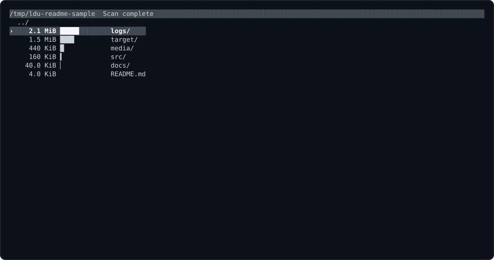
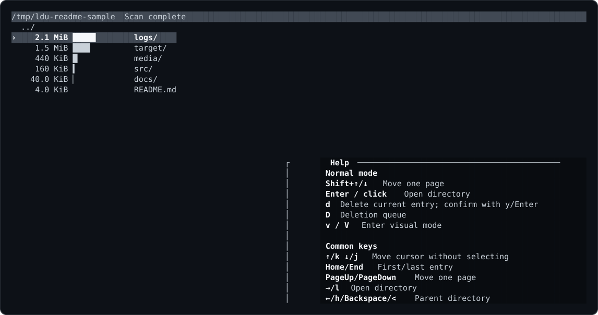

# ldu

**Browse disk usage, preview files, and queue deletions without leaving your terminal.**

Fast, interactive disk-space exploration with keyboard and mouse controls. Navigate directories, see where space goes, inspect files, and review deletions before committing them.



<details>
<summary>See the keyboard shortcuts and help screen</summary>



</details>

## Install

**Arch Linux / EndeavourOS / Manjaro**

Until AUR registration reopens, install directly from the maintained `PKGBUILD` in this repository. This does **not** require an AUR account or helper:

```sh
sudo pacman -S --needed base-devel git
git clone https://github.com/SmallThingz/ldu.git
cd ldu/packaging/aur/ldu-bin
makepkg -si
```

To compile the package on Arch instead, run `makepkg -si` from `packaging/aur/ldu/` (requires Rust 1.99.0; see [Building from source](#building-from-source)). The packages are **not yet published to AUR**.

**NixOS (x86-64 or ARM64)**

```sh
nix --extra-experimental-features 'nix-command flakes' profile install github:SmallThingz/ldu
```

**macOS ([Homebrew](https://brew.sh))**

```sh
brew install SmallThingz/tap/ldu
```

**Other Linux distributions and FreeBSD (Bash and curl)**

```sh
bash -o pipefail -c 'curl -fsSL https://raw.githubusercontent.com/SmallThingz/ldu/v0.1.0/scripts/install.sh | bash'
```

The script installs to `~/.local/bin`; add that directory to `PATH`.

## Usage

```sh
ldu                 # inspect the current directory
ldu ~/Downloads     # inspect another directory
```

Use arrow keys or `j`/`k` to move, Enter to open a directory, `?` for help, `v` for visual selection, and `D` for the deletion queue. Deletion requires confirmation.

## Building from source

You need **Rust 1.99.0**, Cargo, and a C toolchain. The repository pins the Rust toolchain in `rust-toolchain.toml`.

```sh
git clone https://github.com/SmallThingz/ldu.git
cd ldu
rustup toolchain install 1.99.0  # if not already installed
cargo build --locked --release
./target/release/ldu
```

To install the compiled executable for your user:

```sh
install -Dm755 target/release/ldu "$HOME/.local/bin/ldu"
```

Make sure `~/.local/bin` is in your `PATH`. On Arch, install the build prerequisites with `sudo pacman -S --needed base-devel git rustup`, and select Rust 1.99.0 with `rustup toolchain install 1.99.0`. On other platforms, use the equivalent Rust and C build tools.

## More information

[Controls and configuration](docs/behavior.md) · [Platforms and builds](docs/releasing.md) · [Distribution](docs/distribution.md) · [MIT license](LICENSE)
